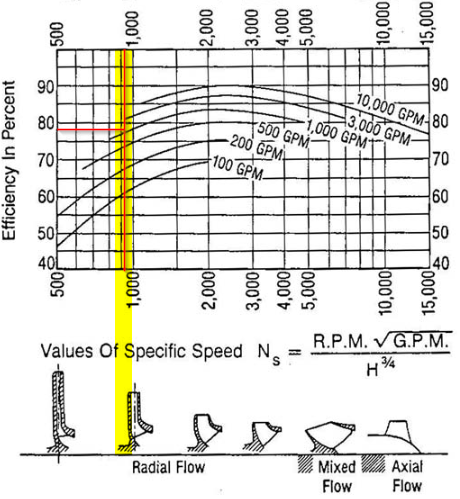
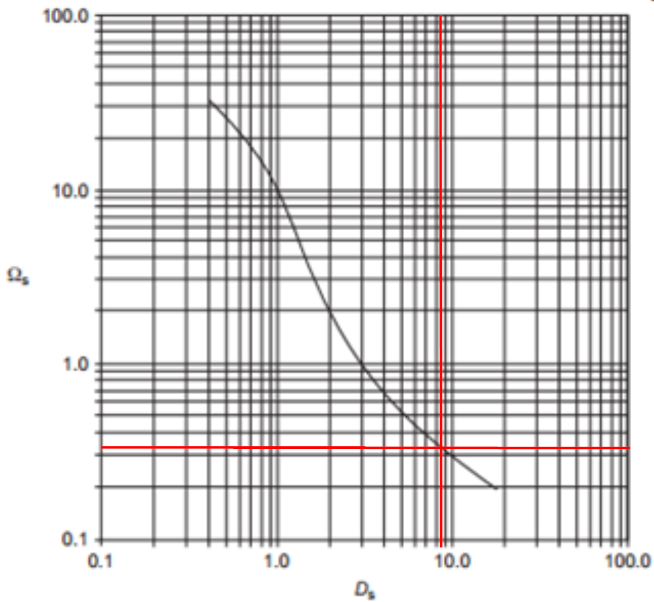
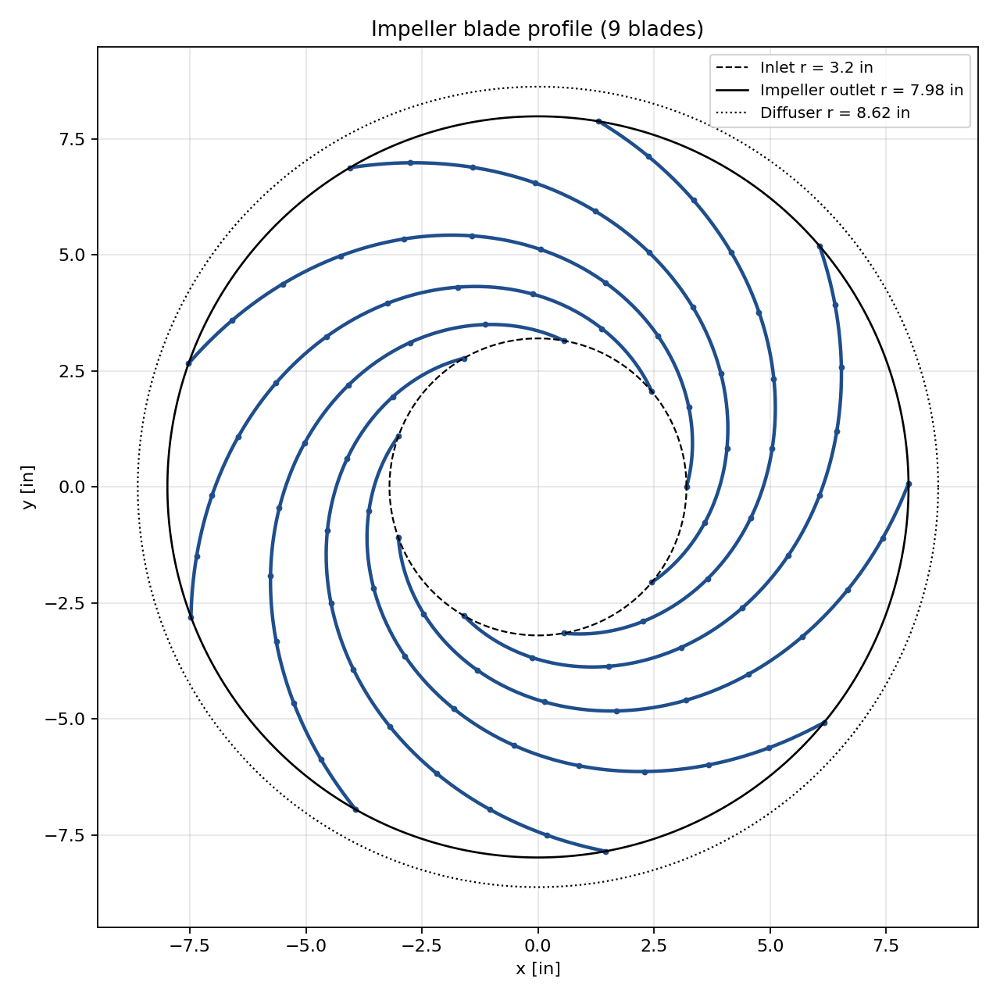

# Centrifugal Water Pump Design

Design report for a centrifugal water pump (Fluid Machinery). Every value below is produced by [`code/pump_design.m`](../code/pump_design.m), which prints a full summary when run in MATLAB.

## Requirements

| Parameter | Value |
|---|---|
| Rotating speed, N | 2500 rpm |
| Flow rate, Q | 1500 gpm |
| Discharge head, H | 500 ft |
| Fluid and conditions | Water, sea level, STP |

**Scope:** impeller selection, inlet and outlet configuration, blade profile, diffuser and volute design, and shaft power.

## Design Inputs

| Input | Value | Note |
|---|---|---|
| Allowable shaft stress, σs | 10,000 psi | 316 stainless steel, safety factor 1.5 |
| Inlet radius, r1 | 3.2 in | Designer's choice |
| Blade angle, inlet / outlet | 17° / 22.5° | Designer's choice |
| Overall efficiency, ηoa | 0.78 | From specific-speed chart |
| Blade thickness | 0.25 in | Assumed |

Impeller design is empirical by nature, so these inputs can be adjusted at the designer's discretion.

## 1. Specific Speed and Impeller Type

$$N_s = \frac{N\sqrt{Q}}{H^{3/4}} = 915.7 \qquad\qquad \omega_s = \frac{\omega\sqrt{Q}}{(gH)^{3/4}} = 0.3349$$

Here Q is in gpm for Ns and ft³/s for ωs.

The dimensional specific speed of 915.7 identifies a **radial-flow impeller** with an efficiency of about 78%.

The non-dimensional specific speed of 0.3349 gives a non-dimensional specific diameter of **Ds ≈ 8.2** from the Cordier diagram. Reading the diagram involves some reader error.

*Source for charts: [add textbook citation].*

The impeller outer diameter follows from the specific diameter:

$$d_2 = \frac{D_s\sqrt{Q}}{(gH)^{1/4}} = 15.97\ \text{in}$$

## 2. Shaft Power

$$P_s = \frac{Q\,\gamma H}{\eta_{oa}} = 133,681\ \text{ft·lbf/s} = 243\ \text{hp}$$

Shaft torque is τ = Ps/ω = 510.6 ft·lbf.

## 3. Inlet Configuration

Shaft diameter from torsion:

$$D_{sh} = \left(\frac{16\,\tau}{\pi\,\sigma_s}\right)^{1/3} = 1.46\ \text{in}$$

| Quantity | Value |
|---|---|
| Shaft diameter | 1.46 in |
| Eye diameter | 5.93 in |
| Blade inlet diameter, d1 | 6.40 in |
| Inlet blade width, b1 | 1.25 in |
| Inlet area | 25.1 in² |
| Inlet velocity, V1 | 19.20 ft/s |
| Blade speed, U1 | 69.8 ft/s |
| Relative velocity, W1 | 72.4 ft/s |
| Relative flow angle, βf1 | 15.38° |

## 4. Outlet Configuration

Blade count from the diameter ratio ν = d1/d2 = 0.401:

$$Z_b = 6.5\,\frac{1+\nu}{1-\nu}\,\sin\!\left(\frac{\beta_{b1}+\beta_{b2}}{2}\right) = 5.13 \;\Rightarrow\; 5 \text{ (rounded)}$$

Slip factor, outlet velocities, and blade width:

$$\mu_s = 1 - \frac{\pi\sin\beta_{b2}}{Z}, \quad V_{u2} = \frac{gH}{\eta_h U_2}, \quad V_{r2} = \left(U_2 - \frac{V_{u2}}{\mu_s}\right)\tan\beta_{b2}$$

Results for the initial blade count (5) and the final blade count (9, see Section 6):

| Quantity | Z = 5 | Z = 9 (final) |
|---|---|---|
| Blade speed, U2 | 174.2 ft/s | 174.2 ft/s |
| Slip factor, μs | 0.7596 | 0.8664 |
| Tangential velocity, Vu2 | 106.1 ft/s | 106.1 ft/s |
| Radial velocity, Vr2 | 14.32 ft/s | 21.45 ft/s |
| Relative velocity, W2 | 69.63 ft/s | 71.44 ft/s |
| Outlet area | 33.6 in² | 22.4 in² |
| Outlet blade width, b2 | 0.72 in | 0.51 in |
| Diffusion factor | 0.962 | 0.987 |

## 5. Blade Profile

The blade angle varies linearly with radius from inlet to outlet, and the wrap angle and blade length are accumulated over 10 radial increments of 0.478 in.

| i | r (in) | βb (°) | Δθ (°) | θ (°) | ΔL (in) | L (in) |
|---|---|---|---|---|---|---|
| 0 | 3.200 | 17.00 | 28.02 | 0.00 | 1.637 | 0.000 |
| 1 | 3.678 | 17.55 | 23.57 | 28.02 | 1.587 | 1.637 |
| 2 | 4.157 | 18.10 | 20.18 | 51.59 | 1.540 | 3.223 |
| 3 | 4.635 | 18.65 | 17.52 | 71.76 | 1.496 | 4.763 |
| 4 | 5.114 | 19.20 | 15.39 | 89.29 | 1.455 | 6.260 |
| 5 | 5.592 | 19.75 | 13.65 | 104.68 | 1.416 | 7.715 |
| 6 | 6.071 | 20.30 | 12.21 | 118.34 | 1.379 | 9.131 |
| 7 | 6.549 | 20.85 | 10.99 | 130.54 | 1.344 | 10.510 |
| 8 | 7.028 | 21.40 | 9.95 | 141.53 | 1.311 | 11.854 |
| 9 | 7.506 | 21.95 | 9.06 | 151.49 | 1.280 | 13.165 |
| 10 | 7.985 | 22.50 | 8.29 | 160.55 | 1.250 | 14.445 |

Total wrap angle: **160.5°**. Total blade length: **14.45 in**.

## 6. Design Checks

| Check | Acceptable range | Z = 5 | Z = 9 (final) |
|---|---|---|---|
| Outlet blade angle | 22.5° to 27.5° | 22.5° ✓ | 22.5° ✓ |
| Solidity | 2.5 to 3.0 | 1.44 ✗ | 2.5914 ✓ |
| Diffusion factor | 0.7 to 1.0 | 0.962 ✓ | 0.9867 ✓ |

With 5 blades the solidity check fails, so the blade count is overridden to **9**. Both solidity and diffusion factor are then within range, giving an acceptable impeller design.

## 7. Diffuser and Volute

| Quantity | Value |
|---|---|
| Diffuser outlet diameter, d3 = 1.08 d2 | 17.25 in |
| Throat velocity, Vt = 0.46√(2gH) | 82.5 ft/s |
| Throat area | 5.83 in² |
| Volute section base width, b = 1.8 b2 | 0.91 in |

The volute cross-section is trapezoidal with a 30° included side angle. Section area, centroid radius, and tangential velocity are iterated until the velocity changes by less than 1%:

| Quantity | Value |
|---|---|
| Section area, Aθ | 2.60 in² |
| Section outer width, a | 1.90 in |
| Section height, h | 1.85 in |
| Centroid radius, rc | 9.66 in |
| Tangential velocity, Vθ | 83.3 ft/s |
| Iterations to converge | 1 |

## 8. Final Design Summary

| Parameter | Value |
|---|---|
| Impeller type | Radial flow |
| Specific speed, Ns | 915.7 |
| Impeller outer diameter | 15.97 in |
| Blade count | 9 |
| Outlet blade width | 0.51 in |
| Shaft diameter | 1.46 in |
| Shaft power | 243 hp |
| Solidity | 2.59 |
| Diffusion factor | 0.987 |
| Diffuser outlet diameter | 17.25 in |

## Reproducing the Results

Open [`code/pump-design.m`](../code/pump-design.m) in MATLAB and run it. Inputs are set at the top of the file, and the summary printed to the command window matches the tables above.