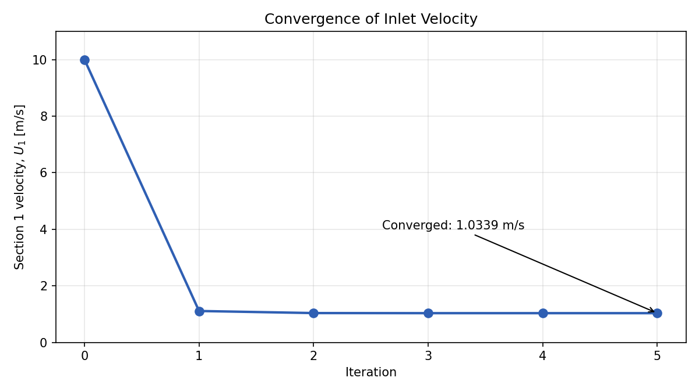

# Residential Water Piping System Analysis

## Abstract

A residential water supply line is made up of three pipe sections: a steel main line and two drawn-copper pipes. The 2.54 cm, 10 m main line is supplied at a static pressure of 550 kPa. It contracts abruptly into a 1.27 cm, 8 m copper pipe that contains two elbows, two inline tees, and a fully open globe valve and rises 6 m. A second abrupt contraction leads to a 0.95 cm, 1 m copper pipe that rises 1 m and discharges to atmosphere (101.325 kPa) through a showerhead.

The extended Bernoulli equation, with major and minor losses, is rearranged in terms of the section 1 velocity and solved by fixed-point iteration in MATLAB. For the 7 m total elevation gain and 448.675 kPa pressure drop, the inlet velocity is 1.0339 m/s, giving a volume flow rate of 31.432 L/min.

## 1. System Description

| Section | Material | Diameter | Length | Features |
|---|---|---|---|---|
| 1 | Commercial steel | 2.54 cm | 10 m | 550 kPa supply; abrupt contraction to section 2 |
| 2 | Drawn copper | 1.27 cm | 8 m | 6 m rise; 2 short-radius 90° elbows, 2 inline tees, 1 fully open globe valve; abrupt contraction to section 3 |
| 3 | Drawn copper | 0.95 cm | 1 m | 1 m rise; discharge to atmosphere through a showerhead (K = 1.5) |

Water is supplied at 20 °C (ρ = 998.2 kg/m³, ν = 1.004×10⁻⁶ m²/s). A drawing of the system is in [figures/piping_diagram.pdf](figures/piping_diagram.pdf).

## 2. Method

### 2.1 Governing equation

Bernoulli's equation for viscous pipe flow with losses, between the supply (1) and the discharge (2):

$$\frac{P_1}{\rho} + \frac{U_1^2}{2} + g z_1 = \frac{P_2}{\rho} + \frac{U_2^2}{2} + g z_2 + \sum f \frac{L}{d}\frac{U^2}{2} + \sum K \frac{U^2}{2}$$

The sums run over the three pipe sections (major losses) and over every fitting, contraction, and the showerhead (minor losses). The major loss in each section depends on a friction factor, and the friction factor depends on the velocity through the Reynolds number, so velocity cannot be solved for directly.

### 2.2 Friction factor

Each friction factor comes from the Haaland correlation, using the Reynolds number

$$Re = \frac{U d}{\nu}$$

and the relative roughness of the pipe material: ε = 0.045 mm for commercial steel and ε = 0.0015 mm for drawn copper.

### 2.3 Minor losses

| Component | K |
|---|---|
| Short-radius 90° elbow | 1.5 |
| Tee, inline flow | 0.9 |
| Globe valve, fully open | 10 |
| Abrupt contraction, section 1 to 2 | 0.41 |
| Abrupt contraction, section 2 to 3 | 0.22 |
| Showerhead | 1.5 |

### 2.4 Solving for velocity

By continuity, the velocity in each section follows from the section 1 velocity:

$$U_i = \frac{A_1}{A_i} U_1$$

Substituting into the Bernoulli equation, every term can be written as a coefficient times $U_1^2$, which leaves

$$U_1 = \sqrt{\frac{\dfrac{P_{in} - P_{out}}{\rho} + g\,(z_{in} - z_{out})}{\dfrac{1}{2}\left(\dfrac{A_1}{A_3}\right)^2 - \dfrac{1}{2} + \displaystyle\sum_i \left(f_i \frac{L_i}{d_i} + K_i\right)\frac{1}{2}\left(\frac{A_1}{A_i}\right)^2}}$$

The friction factors on the right side depend on $U_1$, so the equation is solved iteratively:

1. Start with a guess for $U_1$.
2. Compute the section velocities, Reynolds numbers, and friction factors.
3. Evaluate the equation above for a new $U_1$.
4. Repeat with the new value until the change between successive values is below the tolerance.

### 2.5 Assumptions

- All pressures are absolute.
- Tabulated roughness values and loss coefficients are exact.
- Water properties are uniform and constant at 20 °C.
- Pipe lengths and diameters are exact.

## 3. Implementation

The solver is a single MATLAB script, [`code/piping-system.m`](../code/piping-system.m), organized into inputs, segment geometry, the iteration loop, and a results summary. The Haaland correlation is a local function. The convergence tolerance is 0.01% on the change in $U_1$.

## 4. Results

| Parameter | Value |
|---|---|
| Section 1 velocity | 1.0339 m/s |
| Section 2 velocity | 4.1355 m/s |
| Section 3 velocity | 7.3907 m/s |
| Volume flow rate | 31.432 L/min |
| Friction factor, section 1 | 0.0285 |
| Friction factor, section 2 | 0.0211 |
| Friction factor, section 3 | 0.0200 |
| Final iteration change | 0.00067% |

Reynolds numbers are approximately 2.6×10⁴, 5.2×10⁴, and 7.0×10⁴ in sections 1 to 3, so the flow is turbulent throughout and the Haaland correlation applies.

### Convergence

Starting from a guess of 10 m/s, the solution converges in five iterations:

| Iteration | $U_1$ (m/s) | Change (%) |
|---|---|---|
| 1 | 1.1106 | 800.4 |
| 2 | 1.0373 | 7.07 |
| 3 | 1.0340 | 0.313 |
| 4 | 1.0339 | 0.0144 |
| 5 | 1.0339 | 0.00067 |

The result does not depend on the starting guess: guesses from 0.1 to 100 m/s all converge to 1.0339 m/s in 3 to 5 iterations.

## 5. Conclusion

The system delivers 31.4 L/min at the showerhead, with the flow accelerating from 1.03 m/s in the main line to 7.39 m/s at the outlet as the pipe narrows. The final result is converged well past the 1% velocity accuracy target.
