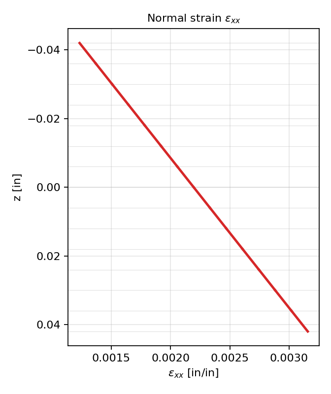
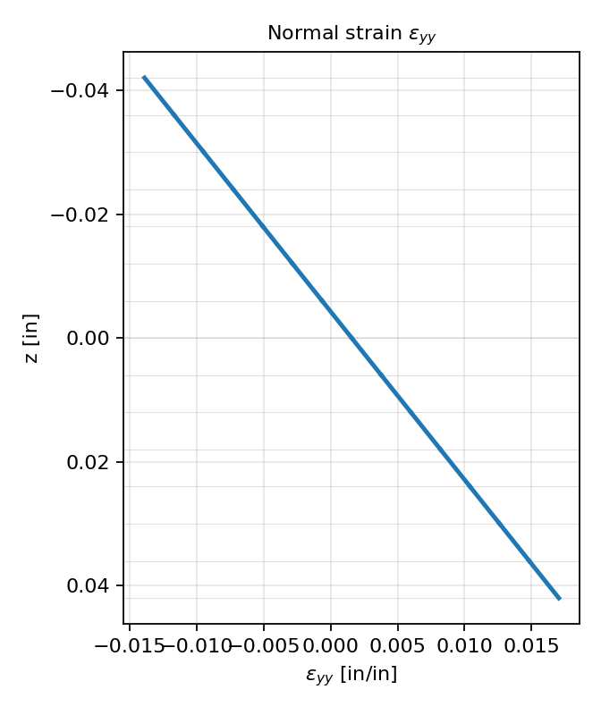
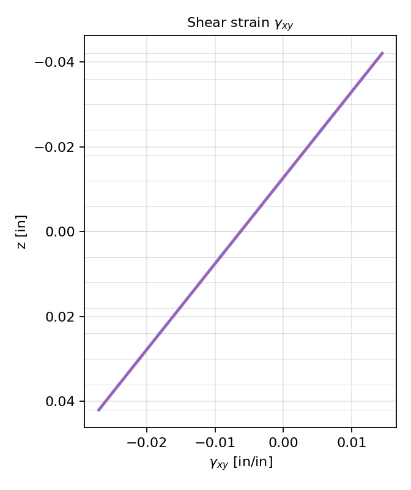
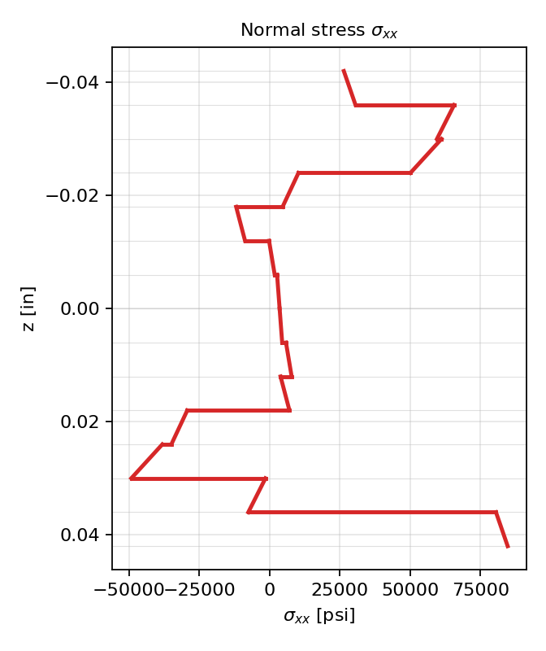
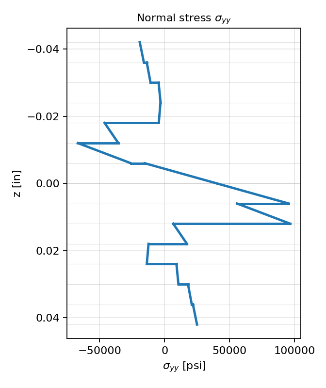
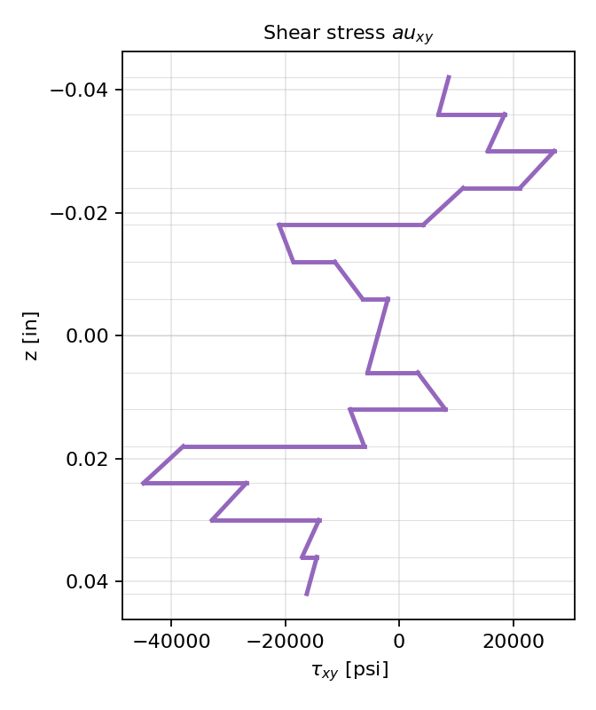
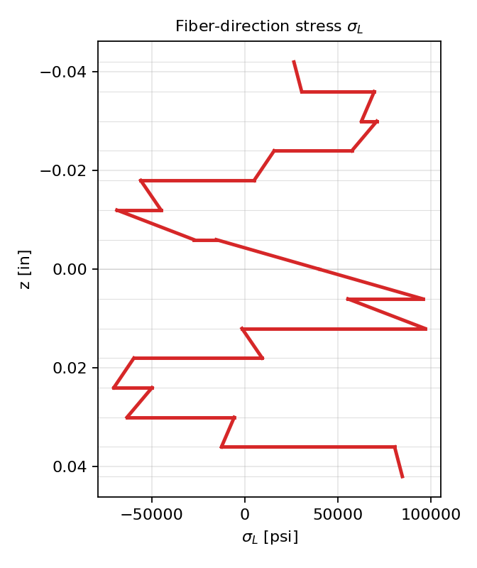
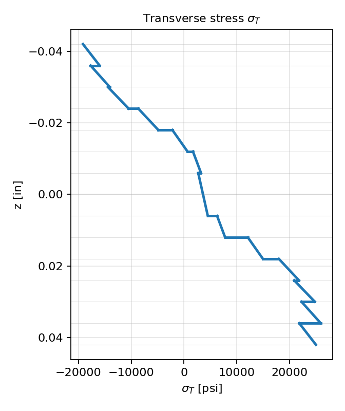
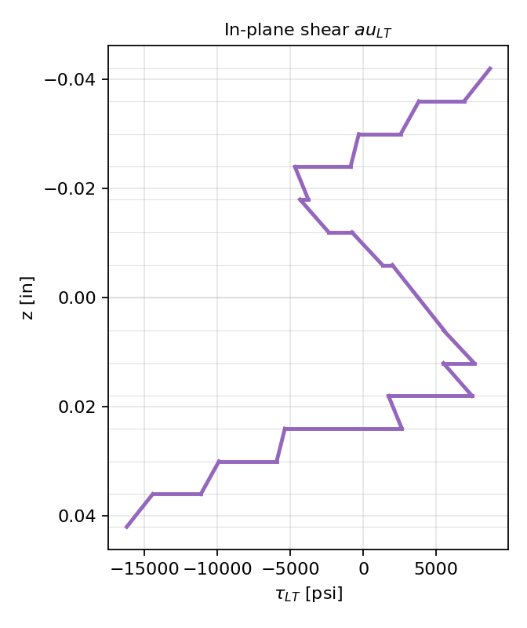
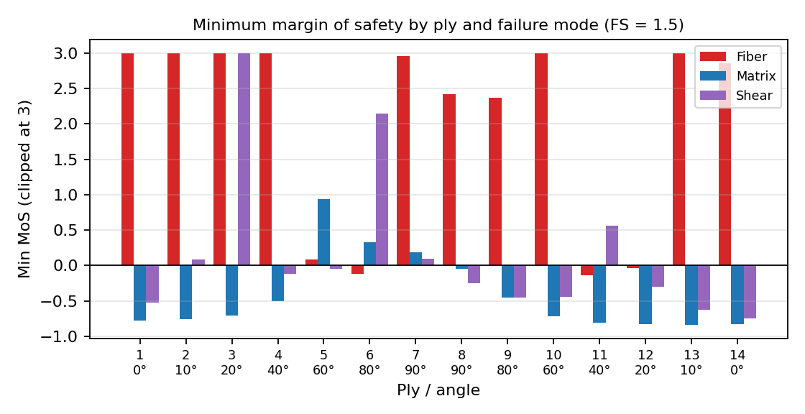

# Laminate Strength Analysis: Classical Lamination Theory and First-Ply-Failure

## 1. Summary

A 14-ply IM7/3501-6 laminate with a [0/10/20/40/60/80/90]s layup was analyzed under combined in-plane loads and moments using Classical Lamination Theory (CLT) and a maximum-stress first-ply-failure check with a factor of safety (FS) of 1.5.

- The applied load set produces a **minimum margin of safety of -0.835**, so the laminate does not meet the design requirement as loaded.
- The critical location is **ply 13 (10°), lower surface, matrix tension**.
- The **critically safe load set (MoS = 0) is 16.5% of the applied loads**.

## 2. Inputs

### 2.1 Loads

| N_x | N_y | N_xy | M_x | M_y | M_xy |
|---|---|---|---|---|---|
| 1000 lb/in | 500 lb/in | -500 lb/in | -20 lb-in/in | 30 lb-in/in | -25 lb-in/in |

### 2.2 Ply properties (IM7/3501-6, Vf = 0.675)

| E_L | E_T | G_LT | ν_LT | Ply thickness |
|---|---|---|---|---|
| 25 Msi | 1.4 Msi | 0.6 Msi | 0.23 | 0.006 in |

| F_L^T | F_L^C | F_T^T | F_T^C | F_LT^S |
|---|---|---|---|---|
| 490 ksi | -91 ksi | 6.4 ksi | -6.4 ksi | 6.2 ksi |

Allowable strengths are the strengths divided by FS = 1.5: 326.7 ksi / -60.7 ksi (fiber, tension / compression), 4.27 ksi / -4.27 ksi (transverse), and 4.13 ksi (shear).

## 3. Method

1. Reduced stiffness **Q** for a unidirectional ply, transformed to laminate axes (**Q̄**) for each ply angle.
2. Laminate stiffness matrices by integration through the thickness:
   A = Σ Q̄ₖ (zₖ - zₖ₋₁), B = ½ Σ Q̄ₖ (zₖ² - zₖ₋₁²), D = ⅓ Σ Q̄ₖ (zₖ³ - zₖ₋₁³)
3. Mid-surface strains ε⁰ and curvatures κ from the constitutive equation [N; M] = [A B; B D] [ε⁰; κ].
4. Strain at any depth: ε(x,y) = ε⁰ + zκ. Ply stress in laminate axes: σ(x,y) = Q̄ₖ ε(x,y).
5. Rotation to material axes: σ(L,T) = T(θ) σ(x,y).
6. Maximum-stress margins of safety for each failure mode, at the top and bottom of every ply: MoS = (allowable / applied) - 1.
7. The critically safe load set is (1 + MoS_min) times the applied set. This scaling is valid because the analysis is linear.

## 4. Results

### 4.1 Laminate stiffness

Units: A in lb/in, D in lb-in.

```
A = [ 1.01e6  1.94e5  2.42e5 ]      D = [ 1.00e3  8.92e1  1.54e2 ]
    [ 1.94e5  8.83e5  2.09e5 ]          [ 8.92e1  1.57e2  6.05e1 ]
    [ 2.42e5  2.09e5  2.17e5 ]          [ 1.54e2  6.05e1  1.03e2 ]
```

**B = 0** because the layup is symmetric, so in-plane and bending behavior are uncoupled.

### 4.2 Mid-surface strains and curvatures

| ε⁰_xx | ε⁰_yy | γ⁰_xy | κ_x | κ_y | κ_xy |
|---|---|---|---|---|---|
| 0.0022 | 0.0016 | -0.0063 | 0.0229 1/in | 0.3685 1/in | -0.4941 1/in |

### 4.3 Strains through the thickness

Strains vary linearly through the thickness and are continuous across ply interfaces.

| ε_xx | ε_yy | γ_xy |
|---|---|---|
|  |  |  |

### 4.4 Stresses through the thickness (laminate axes)

Stresses are piecewise linear. They jump at ply interfaces because each ply has a different transformed stiffness, even though strain is continuous.

| σ_xx | σ_yy | τ_xy |
|---|---|---|
|  |  |  |

### 4.5 Stresses in material axes

| σ_L | σ_T | τ_LT |
|---|---|---|
|  |  |  |

### 4.6 Margins of safety

Minimum margin of safety per ply (top or bottom surface, whichever governs). Negative values indicate the allowable is exceeded.

| Ply | Angle | Fiber | Matrix | Shear |
|---|---|---|---|---|
| 1 | 0° | 9.68 | **-0.777** | **-0.524** |
| 2 | 10° | 3.70 | **-0.759** | 0.085 |
| 3 | 20° | 3.61 | **-0.704** | 3.74 |
| 4 | 40° | 19.7 | **-0.508** | **-0.118** |
| 5 | 60° | 0.086 | 0.933 | **-0.048** |
| 6 | 80° | **-0.117** | 0.330 | 2.15 |
| 7 | 90° | 2.96 | 0.188 | 0.098 |
| 8 | 90° | 2.42 | **-0.051** | **-0.254** |
| 9 | 80° | 2.37 | **-0.451** | **-0.456** |
| 10 | 60° | 33.8 | **-0.714** | **-0.446** |
| 11 | 40° | **-0.138** | **-0.804** | 0.563 |
| 12 | 20° | **-0.041** | **-0.828** | **-0.304** |
| 13 | 10° | 3.85 | **-0.835** | **-0.629** |
| 14 | 0° | 2.86 | **-0.829** | **-0.745** |



**Critical case:** ply 13 (10°), lower surface, matrix tension. The transverse stress is σ_T ≈ 25.9 ksi against an allowable of 4.27 ksi, giving MoS = 4.27 / 25.9 - 1 = **-0.835**.

### 4.7 Critically safe loads (MoS = 0)

Scaling the applied set by (1 + MoS_min) = 0.165:

| N_x | N_y | N_xy | M_x | M_y | M_xy |
|---|---|---|---|---|---|
| 164.9 lb/in | 82.4 lb/in | -82.4 lb/in | -3.30 lb-in/in | 4.95 lb-in/in | -4.12 lb-in/in |

## 5. Discussion

- **Matrix cracking governs.** Eleven of the fourteen plies fail the transverse-tension or transverse-compression check, and the worst cases are the outer plies and the plies adjacent to them. The 0° plies carry load well in the fiber direction but are heavily loaded transversely by the large y-direction curvature and the shear loading.
- **Fiber compression is a secondary concern.** The 20°, 40°, and 80° plies also exceed the fiber compressive allowable, reflecting the low compressive strength (-91 ksi) relative to tensile strength (490 ksi).
- **Moments dominate the outer plies.** Bending produces the largest strains at the outer surfaces, which is why the 0° and 10° plies at the surface govern. Reducing the moments or revising the layup (for example, adding ±45° plies for shear and transverse capacity) would be the natural next design iterations.
- **Limitations.** First-ply failure is conservative, since a laminate typically carries load beyond matrix cracking in a single ply. The maximum-stress criterion ignores interaction between stress components, and thermal and moisture-induced residual stresses are not included.

## 6. Reproducing the Results

Run [`code/composite.m`](code/composite.m) in MATLAB. Inputs are defined at the top of the script. It produces the through-thickness plots and prints the minimum margin of safety and the critically safe load vector.

The figures in this report were generated from an independent reproduction of the same analysis (NumPy/Matplotlib) using identical inputs. The results match the MATLAB script, including MoS_min = -0.835 and the safe load set above.
